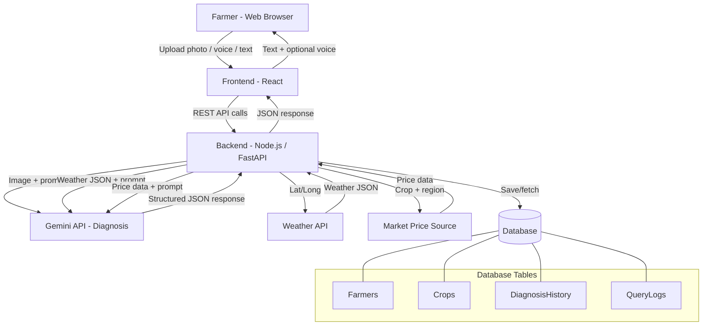

# Krishok Seba: AI-Powered Crop Disease Detection & Farmer Advisory Platform

**A Project Proposal**

---

## 1. Introduction

Smallholder farmers frequently lose crop yield due to late or incorrect disease identification, inefficient irrigation decisions, and lack of access to real-time market information. Most existing solutions address only one of these problems in isolation and are often not accessible to farmers with limited literacy or smartphone experience.

**Krishok Seba** is a web application that combines AI-based image diagnosis, real weather data, and market price information into a single farmer-facing platform — with voice input/output and local-language (Bangla) support to make it genuinely usable in the field.

## 2. Problem Statement

- Farmers often misidentify crop diseases or discover them too late, leading to yield loss.
- Incorrect or excessive pesticide/fungicide use is common due to lack of dosage guidance.
- Irrigation decisions are frequently made without proper weather forecasting.
- Farmers lack easy access to historical and current market prices, weakening their selling decisions.
- Low literacy and limited English proficiency create a barrier to using most digital agri-tools.

## 3. Objectives

1. Detect crop leaf diseases from farmer-uploaded photos using AI.
2. Provide treatment and dosage recommendations for identified diseases.
3. Deliver location-based weather data with a simple irrigation advisory.
4. Show market price trends to support better selling decisions.
5. Make the platform accessible via voice and Bangla language support.
6. Store farmer profiles and diagnosis history for a personalized experience.

## 4. Proposed Features

| Feature                               | Description                                                                                         |
| ------------------------------------- | --------------------------------------------------------------------------------------------------- |
| **Farmer Registration & Profile**     | Farmers register with basic info (name, phone, location, preferred crop, language)                  |
| **Leaf Disease Diagnosis**            | Upload/capture a leaf photo → Gemini (multimodal) identifies disease, severity, and confidence      |
| **Treatment Recommendation**          | Suggested medicine and dosage based on the diagnosed disease                                        |
| **Weather-Based Irrigation Advisory** | Real weather API data → Gemini explains it in simple, actionable irrigation guidance                |
| **Market Price Insight**              | Past/present price trends for the farmer's crop, with a clearly labeled AI-based short-term outlook |
| **Voice Interaction**                 | Speech-to-text input and text-to-speech output for accessibility                                    |
| **Bangla Language Support**           | All AI responses can be generated and read aloud in Bangla                                          |
| **Diagnosis History**                 | Farmers can view past uploads and results tied to their profile                                     |

## 5. System Architecture

The system follows a layered architecture: a frontend client, a backend API layer that orchestrates calls to external services (Gemini, Weather API, Market Price source), and a relational database for persistent farmer/crop/diagnosis data.

**Flow summary:**

1. Farmer interacts via the frontend (photo upload, voice, or text).
2. Backend receives the request and calls the relevant external service:
   - Disease diagnosis → sends image directly to Gemini
   - Weather advisory → fetches real data from a Weather API, then passes it to Gemini for explanation
   - Market insight → fetches/aggregates price data, then passes it to Gemini for summarization
3. Gemini returns a structured JSON response (forced via schema) in the farmer's preferred language.
4. Backend stores relevant records (farmer profile updates, diagnosis history) in the database.
5. Frontend renders the response and optionally reads it aloud via the Web Speech API.

## 6. Database Design

A relational database (PostgreSQL or MySQL) stores farmer and diagnosis data.

**Farmers**

| Column             | Type            | Notes                       |
| ------------------ | --------------- | --------------------------- |
| farmer_id          | UUID / INT (PK) |                             |
| name               | VARCHAR         |                             |
| phone_number       | VARCHAR         | unique                      |
| password_hash      | VARCHAR         |                             |
| location           | VARCHAR / GEO   | district/region or lat-long |
| preferred_language | VARCHAR         | e.g. "bn", "en"             |
| created_at         | TIMESTAMP       |                             |

**Crops**

| Column        | Type            | Notes             |
| ------------- | --------------- | ----------------- |
| crop_id       | UUID / INT (PK) |                   |
| farmer_id     | FK → Farmers    |                   |
| crop_type     | VARCHAR         | e.g. rice, potato |
| planting_date | DATE            |                   |

**DiagnosisHistory**

| Column       | Type            | Notes                  |
| ------------ | --------------- | ---------------------- |
| diagnosis_id | UUID / INT (PK) |                        |
| farmer_id    | FK → Farmers    |                        |
| crop_id      | FK → Crops      |                        |
| image_url    | VARCHAR         | stored image path/link |
| disease_name | VARCHAR         |                        |
| confidence   | FLOAT           |                        |
| severity     | VARCHAR         | low / medium / high    |
| medicine     | VARCHAR         |                        |
| dosage       | VARCHAR         |                        |
| created_at   | TIMESTAMP       |                        |

**QueryLogs** _(optional, for weather/market caching)_

| Column        | Type            | Notes                  |
| ------------- | --------------- | ---------------------- |
| log_id        | UUID / INT (PK) |                        |
| farmer_id     | FK → Farmers    |                        |
| query_type    | VARCHAR         | "weather" / "market"   |
| request_data  | JSON            | input parameters       |
| response_data | JSON            | cached AI/API response |
| created_at    | TIMESTAMP       |                        |

## 7. Technology Stack

| Layer          | Technology                                                                          |
| -------------- | ----------------------------------------------------------------------------------- |
| Frontend       | React, Web Speech API (voice), Browser Geolocation API                              |
| Backend        | Node.js (Express) or Python (FastAPI)                                               |
| AI             | Google Gemini API (free tier) — multimodal diagnosis, structured JSON output        |
| Weather Data   | OpenWeatherMap API (free tier)                                                      |
| Market Data    | Public agricultural price API/source, if available for the target region            |
| Database       | PostgreSQL (or MySQL)                                                               |
| ORM            | Prisma (Node) or SQLAlchemy (Python)                                                |
| Authentication | JWT-based session auth                                                              |
| Deployment     | Frontend: Vercel/Netlify · Backend: Render/Railway · DB: Supabase/Railway free tier |

## 8. Implementation Challenges

| Challenge                                   | Mitigation                                                                     |
| ------------------------------------------- | ------------------------------------------------------------------------------ |
| Free-tier API rate limits (Gemini, Weather) | Cache recent responses in `QueryLogs`; limit repeated calls per farmer/session |
| Inconsistent leaf photo quality             | Client-side checks for blur/resolution before submission                       |
| Market price forecasting accuracy           | Clearly label AI-generated outlooks as estimates, not guarantees               |
| Bangla voice/TTS quality varies by browser  | Test on target devices; fallback to Cloud TTS if Web Speech API voice is weak  |
| Structured JSON output reliability          | Server-side schema validation with a single retry on failure                   |
| Storing farmer data securely                | Hash passwords, use HTTPS, avoid storing raw location beyond what's needed     |

## 9. Expected Outcomes

A working web-based MVP where a farmer can register, upload a leaf photo to get a disease diagnosis with treatment guidance, receive a weather-based irrigation recommendation, view market price trends, and interact with the system by voice in Bangla — with all farmer and diagnosis data persisted for future reference. The UI will be both english and bangla convertable

## 10. Future Scope

- Offline-first mode with an on-device disease detection model
- SMS/WhatsApp bot for farmers without smartphones
- Crowdsourced disease outbreak mapping
- Government scheme and subsidy alerts
- Direct marketplace integration for purchasing recommended medicine
